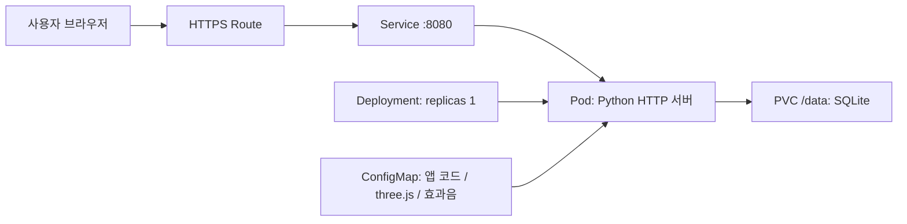
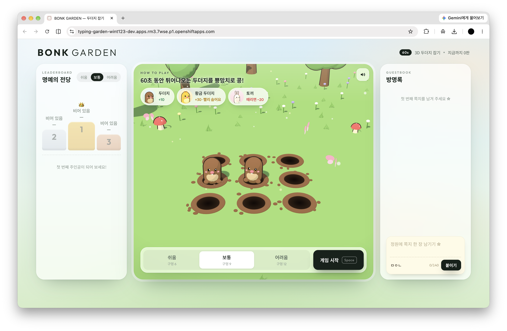

# BONK GARDEN — 3D 두더지 잡기

**202355569 이유민** · 지능형 IoT 플랫폼 컨테이너 과제

## 1. 컨테이너 소개
BONK GARDEN은 3D 정원에서 뿅망치로 두더지를 잡는 웹 게임입니다. 게임이 끝나면 점수를 랭킹에 올릴 수 있고, 방명록에 한마디를 남길 수도 있습니다.

컨테이너 과제라도 직접 해 보고 싶어지는 서비스를 만들고 싶어서 게임을 골랐습니다. 랭킹과 방명록은 다른 사람과 기록을 나누는 기능이라, Pod가 다시 떠도 데이터가 남도록 수업에서 배운 PVC를 써 볼 수 있다는 점도 좋았습니다.

주요 기능은 다음과 같습니다.
- 하늘·언덕·나무·꽃이 있는 정원을 Three.js로 직접 만들었고, 만화 같은 음영과 그림자를 넣었습니다.
- 두더지는 +10점, 황금 두더지는 +30점입니다. 토끼를 때리면 20점이 깎이고 콤보도 끊깁니다.
- 난이도는 세 단계입니다. 구멍이 6개, 9개, 12개로 늘어나고, 어려울수록 동물이 더 자주 나오고 더 빨리 숨습니다.
- 게임 중에는 마우스 커서가 뿅망치로 바뀌고, 맞히면 별과 반짝이 효과가 효과음과 함께 나옵니다.
- 한 판은 60초입니다. 점수, 콤보, 정확도(잡은 수 ÷ 클릭 수), 평균 반응 속도를 보여 줍니다. Esc를 누르거나 다른 탭으로 넘어가면 일시정지됩니다.
- 점수가 100점 오를 때마다 구멍 뒤에 응원하는 토끼가 한 마리씩 나타납니다(최대 12마리).
- 화면 왼쪽에는 랭킹이 있고, 1~3위는 시상대에 올라갑니다. 오른쪽에는 쪽지 모양 방명록이 있습니다.
- 랭킹은 게임이 끝난 뒤 닉네임만 입력하면 등록됩니다. 방명록은 오른쪽 아래 입력칸에서 언제든 쓸 수 있습니다.

## 2. 아키텍처


사용자가 Route 주소로 접속하면 Service를 거쳐 Pod 안의 Python 서버로 요청이 전달됩니다. 서버는 ConfigMap으로 받은 화면 파일을 보내 주고, 랭킹과 방명록은 PVC에 있는 SQLite 파일에 저장합니다.

| Object | 역할 |
|---|---|
| Deployment | Python 서버 Pod 1개를 실행하고 관리합니다. 업데이트할 때는 기존 Pod를 내린 뒤 새로 띄웁니다(Recreate). |
| Service | `app=typing-garden` 라벨이 붙은 Pod의 8080 포트로 요청을 연결합니다. |
| Route | 외부에서 접속할 HTTPS 주소를 만들고, HTTP로 들어오면 HTTPS로 넘깁니다. |
| ConfigMap | 앱 코드(typing-garden-app), three.js(typing-garden-three), 효과음(typing-garden-media)을 나눠 담고, 셋을 projected 볼륨 하나로 합쳐 `/app`에 읽기 전용으로 붙입니다. |
| PVC | 1Gi 저장 공간에 `/data/garden.db`를 두고 랭킹과 방명록을 보관합니다. |
| Probe | startup·liveness·readiness probe로 서버가 떴는지, 살아 있는지, DB까지 준비됐는지 확인합니다. |

SQLite는 여러 Pod가 같은 파일을 동시에 쓰기 어렵고, PVC도 한 노드에만 붙일 수 있는 방식(RWO)이라 Pod는 1개만 두었습니다. 그래서 업데이트하는 동안 잠깐 접속이 끊길 수 있습니다. 자원은 CPU 50m·메모리 96Mi를 요청하고, 최대 CPU 500m·메모리 256Mi까지 쓰도록 제한했습니다. Pod는 root가 아닌 임의의 사용자로 실행되고, 권한 상승도 막아 두었습니다.

## 3. 사용 이미지
- 이미지: `registry.access.redhat.com/ubi9/python-312@sha256:2c7a89f9f1e69f2a00036041ef744b45c8830bebcb2f7194f403ca93729bb0cc`
- 포트: `8080` (실행 명령: `python3 /app/server.py`)

Red Hat이 공개한 UBI Python 이미지라서, OpenShift처럼 root가 아닌 임의의 사용자로 실행하는 환경에서도 문제없이 동작합니다. 서버는 Python 표준 라이브러리의 HTTP 서버와 SQLite만 써서, 패키지를 추가로 설치하거나 이미지를 따로 빌드할 필요가 없습니다. 실제로 배포해 동작을 확인한 버전으로 고정하려고 태그 대신 digest를 적었습니다.

## 4. 배포 방법
본인 Sandbox에 `oc login`으로 로그인하고 본인 프로젝트를 선택한 뒤, 저장소 최상위 폴더에서 다음 명령을 실행합니다(학번 폴더 안에서는 `oc apply -f k8s/`). 로그인 토큰은 Git에 올리지 않습니다.

```bash
oc apply -f students/202355569/k8s/
oc rollout status deployment/typing-garden
oc get pods
oc get route typing-garden
```

YAML에는 namespace와 Route 주소를 적지 않았기 때문에 누구의 프로젝트에서든 그대로 배포됩니다.

배포가 끝나면 이렇게 확인합니다.
- `oc get route typing-garden`에 나온 HOST 앞에 `https://`를 붙여 브라우저로 열면, 가운데 3D 게임 창과 양옆에 랭킹·방명록이 있는 시작 화면이 나옵니다.
- `curl https://<HOST>/api/ready`를 보내면 DB 연결까지 확인한 뒤 `{"ready": true}`로 응답합니다.

게임 시간은 deployment.yaml의 `GAME_DURATION`(초)으로 바꿀 수 있습니다. 화면에 적힌 안내 문구는 60초 기준이라 시간을 바꾸면 문구도 함께 고쳐야 합니다.

코드를 고칠 때는 `src/` 폴더의 파일을 수정하고 `python3 build.py`를 실행합니다. 그러면 `k8s/configmap*.yaml`이 다시 만들어지고, 이를 적용한 뒤 `oc rollout restart deployment/typing-garden`으로 Pod를 다시 띄우면 됩니다. build.py는 파일을 ConfigMap에 넣을 때 용량 제한(6번 참고)을 넘지 않도록 알아서 나눠 담고, deployment.yaml의 볼륨 목록도 함께 맞춰 줍니다.

## 5. 배포 결과
본인 프로젝트(wint123-dev)에 배포해 Pod가 Running 상태인 것과 롤아웃이 성공한 것을 확인했습니다. 모든 리소스를 `oc delete -f k8s/`로 지운 뒤 `oc apply -f k8s/`만으로 다시 배포해도 정상 동작하는 것을 확인했고, 아래는 그 직후의 상태입니다. 공개 주소에서 `/api/ready`도 `{"ready": true}`로 응답했습니다.

- 배포 주소: https://typing-garden-wint123-dev.apps.rm3.7wse.p1.openshiftapps.com
- 출력 원본: [deployment-status.txt](images/deployment-status.txt)

```text
$ oc get deployment,pod,service,route,pvc
NAME                            READY   UP-TO-DATE   AVAILABLE   AGE
deployment.apps/typing-garden   1/1     1            1           5m13s

NAME                                 READY   STATUS    RESTARTS   AGE
pod/typing-garden-7f54bbbc9b-nxvv8   1/1     Running   0          5m13s

NAME                        TYPE        CLUSTER-IP       EXTERNAL-IP   PORT(S)                               AGE
service/typing-garden       ClusterIP   172.30.199.142   <none>        8080/TCP                              5m12s

NAME                                     HOST/PORT                                                      PATH   SERVICES        PORT   TERMINATION     WILDCARD
route.route.openshift.io/typing-garden   typing-garden-wint123-dev.apps.rm3.7wse.p1.openshiftapps.com          typing-garden   http   edge/Redirect   None

NAME                                       STATUS   VOLUME                                     CAPACITY   ACCESS MODES   STORAGECLASS   VOLUMEATTRIBUTESCLASS   AGE
persistentvolumeclaim/typing-garden-data   Bound    pvc-6e753963-0899-46d2-8253-c10b934c9184   1Gi        RWO            gp3            <unset>                 5m13s

$ curl https://typing-garden-wint123-dev.apps.rm3.7wse.p1.openshiftapps.com/api/ready
{"ready": true}
```



이 밖에 확인한 내용입니다.
- 브라우저에서 데스크톱과 모바일 크기로 시작 화면, 난이도 바꾸기, 게임 진행, 일시정지, 결과·랭킹 등록, 방명록 작성이 모두 잘 되는지 봤습니다.
- 서버가 다시 계산한 점수가 화면에 나온 점수와 같은지 확인했습니다.
- `oc rollout restart`로 Pod를 새로 띄운 뒤에도 랭킹과 방명록이 남아 있었습니다.

재배포 검증에 사용한 명령은 아래와 같습니다. PVC까지 지워지므로 저장된 기록이 모두 사라진다는 점에 주의해야 합니다.
```bash
oc delete -f k8s/
oc apply -f k8s/
oc rollout status deployment/typing-garden
```

## 6. 어려웠던 점
**ConfigMap이 너무 커서 적용이 안 됐습니다.** three.js 파일(약 670KB)을 ConfigMap에 넣었더니 `metadata.annotations: Too long` 오류가 났습니다. 찾아보니 `oc apply`가 적용한 내용을 통째로 annotation에 저장하는데, 이 annotation의 최대 크기가 256KB였습니다. three.js를 gzip으로 압축해(약 166KB) 저장하고 서버가 압축된 그대로 보내도록 바꿨습니다. 또 코드, three.js, 효과음을 ConfigMap 세 개로 나눈 뒤 projected 볼륨으로 한 폴더에 합쳤습니다.

**코드를 고쳐서 적용했는데 화면이 그대로였습니다.** ConfigMap만 바뀌고 Deployment는 그대로라서 `oc apply` 결과가 `unchanged`로 나왔고, 이미 떠 있던 서버가 예전 파일을 계속 보내고 있었습니다. 적용한 뒤 `oc rollout restart deployment/typing-garden`으로 Pod를 새로 띄워서 해결했습니다.

**기능을 바꾸면서 DB 구조가 달라졌습니다.** 새 버전에서 테이블에 칸(컬럼)을 추가했는데, PVC에 남아 있던 기존 DB에는 그 칸이 없었습니다. 서버가 시작할 때 테이블 구조를 확인해서 없는 칸만 추가하도록 고쳤습니다.

**효과음 파일을 바로 받을 수 없었습니다.** Pixabay가 자동 다운로드를 막아서 브라우저로 mp3를 직접 받았고, 앞뒤 무음을 잘라서 넣었습니다. 망치나 두더지 소리처럼 게임 중에 나는 효과음은 Web Audio로 직접 만들었습니다.

**점수를 조작하기 쉬운 구조였습니다.** 브라우저가 보내 주는 점수를 그대로 저장하면 쉽게 조작할 수 있습니다. 그래서 두더지가 언제, 어느 구멍에서 나올지를 서버가 게임 시작 때 미리 정해 두고, 끝나면 맞힌 기록만 받아 점수를 직접 다시 계산하게 했습니다.

## 7. AI·참고자료 활용 내역
- Codex: 과제 요구사항 정리, 첫 버전의 화면 디자인·게임·API·YAML·README 초안 작성
- Claude Code: 3D 두더지 잡기 게임과 정원 제작, 서버 점수 검증, 랭킹·방명록 화면, ConfigMap을 나눠 만드는 build.py 작성, 배포 확인
- three.js r160 (MIT 라이선스): https://threejs.org
- 버튼 클릭음: Pixabay "spacebar click keyboard" https://pixabay.com/sound-effects/film-special-effects-spacebar-click-keyboard-199448/
- 3D 정원과 동물은 three.js 기본 도형을 조합해 만들었습니다.
- 과제 안내: 나만의 컨테이너 만들기(3~10쪽)
- 강의자료: 실제 운영 환경에서의 고려사항, OpenShift 실습(2), 핸즈온 워크샵 매뉴얼
- https://kubernetes.io/docs/concepts/configuration/configmap/
- https://kubernetes.io/docs/concepts/storage/persistent-volumes/
- https://docs.python.org/3/library/sqlite3.html
- https://developer.mozilla.org/en-US/docs/Web/Media/Guides/Autoplay

AI가 만든 코드와 YAML은 Sandbox에 직접 배포해서 동작을 확인했고, YAML의 각 항목이 어떤 역할을 하는지 검토했습니다.

## 부록. 게임 규칙과 한계
- 3D 화면이라 WebGL을 지원하는 브라우저가 필요합니다. 지원하지 않으면 안내 문구가 나옵니다.
- 게임을 시작하면 서버가 60초 동안 언제, 어느 구멍에서, 얼마나 오래, 어떤 동물이 나올지 미리 정합니다. 한 구멍에서 동물이 완전히 들어간 뒤에야 다음 동물이 나옵니다.
- 난이도별로 동물이 나오는 간격과 머무는 시간이 다릅니다. 쉬움은 구멍 6개에 약 0.95초 간격·1.35초 머무름, 보통은 9개에 0.72초·1.05초, 어려움은 12개에 0.5초·0.78초입니다. 황금 두더지는 다른 동물보다 머무는 시간이 25% 짧습니다.
- 점수는 두더지 10점, 황금 두더지 30점에 난이도 배율(쉬움 1, 보통 1.3, 어려움 1.6)을 곱하고, 콤보 보너스(콤보 × 2점, 최대 40점)를 더해 계산합니다. 토끼를 때리면 20 × 배율만큼 깎이고 콤보가 끊기며, 두더지를 놓쳐도 콤보가 끊깁니다. 최종 점수는 0점 아래로 내려가지 않습니다.
- 정확도는 잡은 두더지 수를 클릭 수로 나눈 값이고, 반응 속도는 두더지가 나온 뒤 맞힐 때까지 걸린 시간의 평균입니다.
- 서버는 맞힌 시점이 실제로 동물이 나와 있던 시간 안인지, 같은 동물을 두 번 맞히지 않았는지 확인합니다. 다만 클릭 수와 타격 기록 자체는 브라우저가 보낸 값을 믿기 때문에 완벽한 부정행위 방지는 아닙니다.
- 랭킹은 난이도별 상위 30개, 방명록은 최근 60개까지 보여 줍니다. 랭킹은 한 판에 한 번, 두더지를 하나 이상 잡았을 때만 등록할 수 있습니다. 방명록은 같은 IP에서 10초에 한 번만 쓸 수 있습니다.
- 닉네임은 1\~12자, 방명록은 1\~140자입니다. DB에 넣을 때는 매개변수 방식으로 넣고 화면에는 글자 그대로 표시해서, 입력값이 SQL이나 HTML로 실행되지 않게 했습니다. 요청 크기도 제한합니다.
- 난이도, 소리 설정, 닉네임은 지금 쓰는 브라우저에만 저장됩니다.
- 학습용 소규모 서버라 회원 가입이나 대규모 접속 처리는 넣지 않았습니다.
